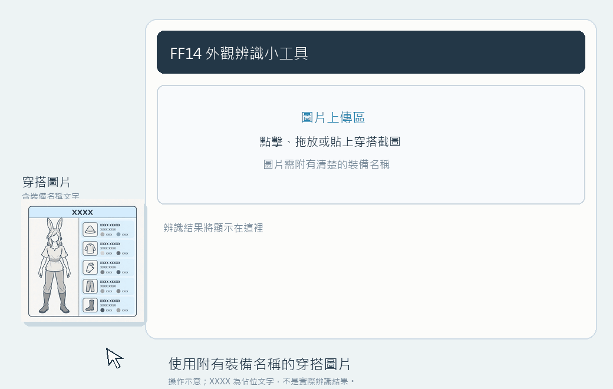

# FF14 幻化外觀 AI 辨識小工具

讀取**附有裝備名稱文字**的 FF14 穿搭圖片，將名稱比對至裝備資料庫，整理取得方式與圖片中的染色資訊，方便查找與保存。

[線上使用](https://dx90c.github.io/ff14-glamour-ai/) · [下載完整檔案](https://github.com/dx90c/ff14-glamour-ai/releases/download/v2.6.1/FF14-Glamour-v2.6.1.zip) · [下載 HTML](https://github.com/dx90c/ff14-glamour-ai/releases/download/v2.6.1/FF14-Glamour-v2.6.1.html) · [下載裝備庫 JSON](https://github.com/dx90c/ff14-glamour-ai/releases/download/v2.6.1/ff14_database_v2.6.1.json)

## 功能與限制

- 在同一張輸入卡片貼上 X／Twitter 貼文網址，或選擇、拖放、貼上截圖。
- 網址模式取得貼文的全部圖片，逐張使用本機 OCR；無裝備匹配的圖片略過，多張成果可切換查看。
- 比對裝備名稱，查詢來源庫收錄的取得方式，提供灰機 Wiki 與 Google 搜尋連結。
- 讀取染劑名稱文字，並依文字位置配對裝備；不能僅憑衣服顏色判斷染劑。
- 依已收錄資料顯示跨職業、種族與性別限制提醒。
- 作者名稱顯示在預覽照片下方，點擊連回原貼文；三種匯出都保留來源。
- 匯出含原圖的 XLSX，或下載 CSV、PNG。XLSX 保留裝備原名、取得方式、染色、疑似匹配與穿搭提醒，圖片放在 F 欄等比例縮放。
- 對部分未匹配、低信心或小字區域自動裁切放大重讀，維持原有名稱匹配門檻。雙語名稱與染劑可依位置合併；兩個明確色槽使用相同染劑時保留兩槽。

**本工具沒有提供僅憑角色外觀辨認裝備的可靠功能。** 使用 OCR 或 AI API，都建議提供帶有清楚裝備名稱的圖片。

名稱庫支援繁中、簡中、英文、日文、法文、德文與韓文。預設 PaddleOCR 模型主要支援中、英、日文；法文、德文尚未完整實測。韓文圖片會在原模型匹配不足時自動嘗試韓文模型，依物品 ID 對照中文名稱與灰機連結；仍可能有漏讀或誤匹配。

圖片小字、模糊文字、特殊排版可能造成錯字或漏讀。免費 OCR 模式目前只列出成功匹配的裝備，表格可能不完整。

「疑似匹配」表示系統依字形或錯字差異推測候選，請核對名稱；「未辨識染色」不代表沒有染色。染色與裝備的配對也可能出錯。模型信心分數不等於結果正確率。

取得方式與限制資料並非全部收錄，且可能因伺服器或版本而不同。沒有出現穿搭提醒，不代表整套裝備沒有使用限制。

左右雙欄的裝備說明在條件足夠時會分成兩套，染色與限制提醒各自配對；可用成果按鈕切換，預覽框標示對應的一側，匯出保留完整原圖。不符合分組條件時沿用原分類。目前僅驗證一張真實雙欄案例，交錯或模糊文字不保證能分組。

## 使用方式

1. 開啟線上版，貼上 X 貼文網址並按「讀取整篇圖片」，或直接貼上、拖入、選擇圖片。
2. 預設使用免費 PaddleOCR，不需 API Key。首次辨識會從本站載入引擎與模型，無需手動下載或安裝，請保持網路連線。
3. 查看結果，核對疑似匹配與染色，再使用搜尋連結或匯出結果。

如需使用 AI API，可在「辨識模型」設定中選擇 Gemini、ChatGPT（OpenAI API）或其他 OpenAI 相容服務，填入自己的 API Key。費用與額度依服務商規定，程式不會自動由 OCR 切換至 AI。

### 圖片格式與操作示範

請使用附有清楚裝備名稱的穿搭圖片。網頁尚未顯示成果時，可展開「查看圖片格式與操作示範」，並隨時收起。

XXXX 為佔位文字，不是實際辨識結果。

## 下載版與資料更新

下載完整 ZIP 後，完整解壓並雙擊 `start.bat`。會自動開啟本機網頁，不需另裝 Node 或 Python。啟動視窗需保持開啟，關閉後服務停止。包內有中英文 README，檔名使用英文；解壓路徑可包含中文或空白。

完整包適用 Windows，需可執行內建 Windows PowerShell，建議 Chrome 或 Edge。服務僅監聽 `127.0.0.1`，預設埠 48731，被占用時自動選下一個可用埠。包內包含 OCR 引擎、中英日與韓文模型、JSON、XLSX 元件與示範圖，預設 OCR 可在不連外的情況使用。AI API、搜尋與資料同步仍需網路。

**免費 OCR 需要 HTTP(S)，請用啟動器開啟。** 單獨下載 HTML 並雙擊開啟時，僅能使用 AI API；首次需手動匯入 JSON。含圖 XLSX 還需要同層的 `xlsx` 資料夾，因此建議使用完整 ZIP。

線上版的模型由本專案 GitHub Pages 提供，中英日與韓文模型合計約 35 MB；首次由瀏覽器取得並嘗試快取，清除網站資料或模型版本變更時需重新載入。XLSX、CSV、PNG 都在瀏覽器產生，不會因匯出而上傳圖片。PNG 包含結果與完整原圖，保留署名及水印；PNG 無可點擊連結，可編輯資料請選 XLSX 或 CSV。

XLSX 檔名為 `YYYYMMDD標題_HHmmss.xlsx`；沒有可用標題時使用身體裝備名稱，再依序使用第一件裝備名稱、FF14外觀筆記。日期與時間採使用者瀏覽器的本機時間。保留原圖中的署名與水印；匯出檔案不代表取得原作者的公開轉載授權。

遊戲改版後按「一鍵同步庫」，名稱、取得方式、部位與穿搭限制會隨各自來源一起更新。已最新且索引完整的來源會略過下載；失敗時再次按同一按鈕即可重試，已完成的來源會保留。

- **線上版**：資料保存在目前瀏覽器，關閉頁面後仍會保留；清除網站資料或更換瀏覽器後需重新載入。
- **下載版**：資料也保存在目前瀏覽器。若要同步寫回資料夾中的 JSON，請使用支援資料夾寫入的瀏覽器（如 Chrome、Edge），首次同步時選擇完整包的資料夾並授權，即可自動寫回 ff14_database.json。瀏覽器資料依網址與連接埠分開保存；啟動埠變更時會重新載入包內 JSON。

網址取圖使用 [FxEmbed 公開服務](https://docs.fxembed.com/api/introduction/)，需要網路；私人、刪除貼文或服務異常時可能無法取得圖片。網址模式固定使用本機 OCR，不會呼叫付費 AI API。多圖無結果時保留原成果，下載失敗及引擎故障仍會提示。CSV 與 XLSX 共用日期、名稱、時間命名規則；CSV 的作者和網址使用兩個欄位，PNG 在原圖下方顯示來源。

## 隱私

PaddleOCR 在使用者瀏覽器內處理圖片，不將圖片傳送至 OCR 服務。引擎與模型由本專案 GitHub Pages 載入，資料同步會連線至各公開來源庫。模型原始來源與 SHA-256 可在 [模型清單](ocr/models/manifest.json) 查看。

使用 X 貼文網址時，瀏覽器會向 FxEmbed 查詢貼文 ID，再向 X 圖片服務下載圖片；這些服務可取得連線 IP 等一般請求資訊。圖片 OCR 仍在本機執行。

API Key 儲存在本機瀏覽器。使用 AI API 時，圖片與驗證所需的 API Key 會直接傳送至所選服務商或自訂端點，本專案沒有代收圖片與金鑰的後端服務。

## 資料來源

| 來源 | 用途 | 授權 |
| --- | --- | --- |
| [InfSein](https://github.com/InfSein/ffxiv-datamining-mixed) | 五語裝備名稱、裝備描述中明載的種族與性別條件 | 請參閱來源專案 |
| [Teamcraft](https://github.com/ffxiv-teamcraft/ffxiv-teamcraft) | 繁中／韓文名稱、取得方式、部位與職業資料 | MIT |
| [LuminaSupplemental](https://github.com/Critical-Impact/LuminaSupplemental) | 補充取得方式 | GPL-3.0 |
| [OpenCC](https://github.com/BYVoid/OpenCC) | 簡繁字形輔助匹配 | Apache-2.0 |
| [ExcelJS](https://github.com/exceljs/exceljs) | 含圖 XLSX 匯出 | MIT |
| [PaddleOCR](https://github.com/PaddlePaddle/PaddleOCR) | 圖片文字辨識 | Apache-2.0 |

取得方式優先使用物品 ID 對應的來源記錄，不以 AI 推測內容作為已驗證來源。資料版本可在工具的裝備庫視窗查看。

ExcelJS 授權見 [授權檔](xlsx/ExcelJS-LICENSE.txt)。OCR 第三方授權見 [授權說明](ocr/THIRD_PARTY_NOTICES.md)，版本更新見 [CHANGELOG](CHANGELOG.md)。
